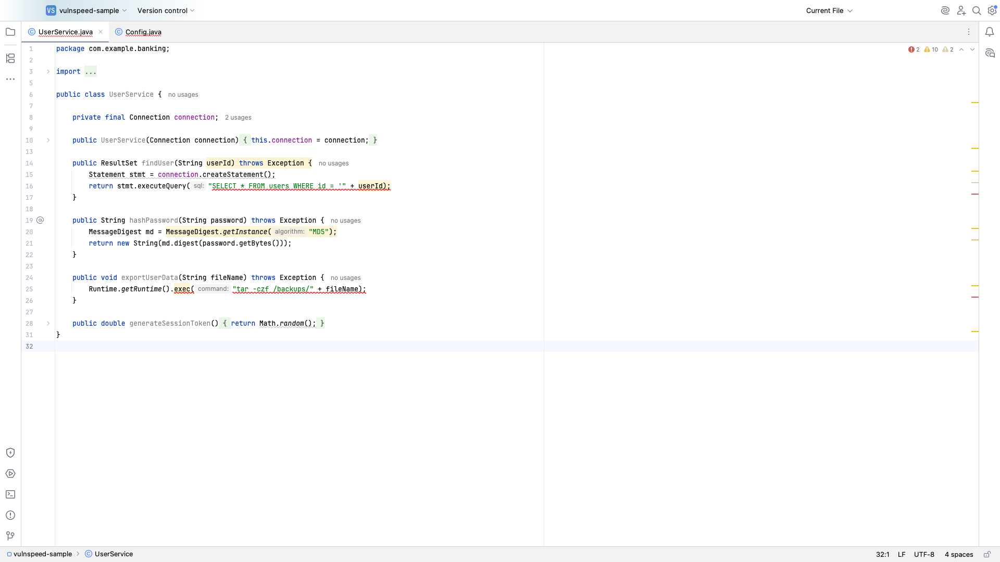
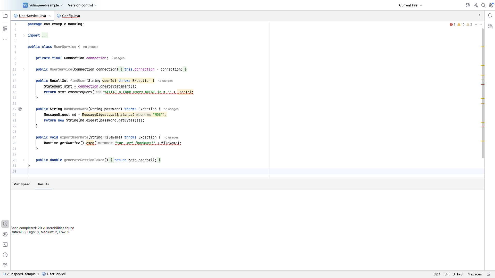
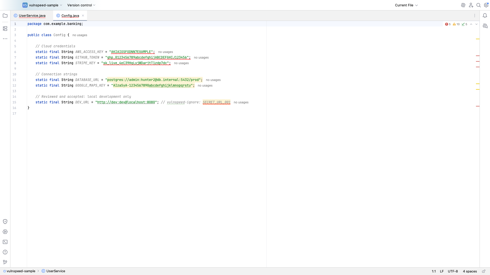
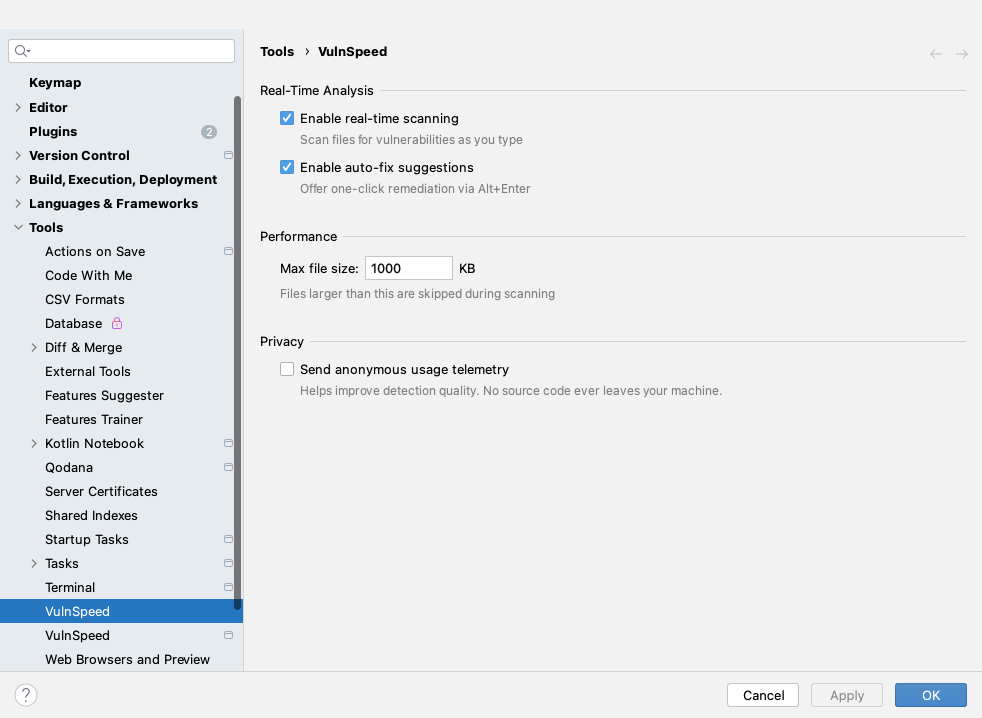

# VulnSpeed SAST

[](LICENSE) 

> **Free & open source.** Since 2026.8.0 the plugin is completely free — every feature is unlocked for everyone, no license needed — and the source code is available under the Apache License 2.0.

Static application security testing (SAST) plugin for JetBrains IDEs. Real-time vulnerability detection across Java, Kotlin, Python, C/C++, JavaScript, TypeScript, and Swift with OWASP Top 10 and CWE Top 25 coverage.

## Screenshots

| Inline detection in the editor | Security dashboard |
|---|---|
|  |  |

| Secrets detection | Settings |
|---|---|
|  |  |

## Features

- **Real-time vulnerability detection** — annotators scan code as you type with inline severity highlighting for Java, Kotlin, Python, JavaScript, and TypeScript
- **Secrets detection** — 12 high-signal rules for AWS, GitHub, GitLab, Slack, Stripe, Google, SendGrid, Twilio, npm tokens, private keys, JWTs, and credentials in URLs (CWE-798)
- **Inline suppression** — `// vulnspeed-ignore` or `// vulnspeed-ignore: RULE_ID` accepts a finding in place; `vulnspeed-ignore-file` opts out a generated file
- **Shareable HTML report** — export the latest scan as a single self-contained HTML file with severity summary and CWE links
- **Multi-language support** — full scanning for Java, Python, C/C++, JavaScript, TypeScript, and Swift
- **OWASP Top 10 coverage** — detects all 10 categories including injection, broken access control, cryptographic failures, SSRF, and more
- **CWE Top 25 coverage** — SQL injection (CWE-89), XSS (CWE-79), OS command injection (CWE-78), information disclosure (CWE-200), and 21+ more
- **Remediation guidance** — every finding carries a fix suggestion with OWASP / CWE references
- **Scan file** — right-click in editor → "Scan File with VulnSpeed" for on-demand analysis
- **Scan on save** — optional per-project setting that re-scans a file whenever it is saved
- **Scan project** — right-click project folder → "Scan Project with VulnSpeed" for full project scanning
- **VulnSpeed tool window** — bottom panel displaying vulnerability list and statistics
- **Configurable settings** — toggle real-time scanning, set the max file size to scan, enable scan on save
- **Standalone CLI for CI** — `vulnspeed-cli-<version>.jar` (attached to every GitHub release) runs the same rules without an IDE: scan to findings JSON / SARIF, baseline compare and CVE enrichment, with exit codes for gating
- **Findings JSON export** — Tools → VulnSpeed → Export Findings JSON hands an IDE scan to the CLI

## Installation

1. **JetBrains Marketplace**: Settings → Plugins → Marketplace → Search "VulnSpeed"
2. **Manual**: Download from [Releases](https://github.com/JirakJ/vulnspeed-plugin/releases) → Settings → Plugins → ⚙️ → Install from disk

## Requirements

- IntelliJ IDEA 2025.1+ or any JetBrains IDE (PyCharm, WebStorm, CLion, etc.)
- 2 GB free RAM

## Configuration

Settings → Tools → VulnSpeed (two pages: application-wide and per-project).

| Setting | Scope | Default | Effect |
|---|---|---|---|
| Enable real-time scanning | IDE | on | Turns the as-you-type editor highlighting on or off. Manual scans keep working. |
| Max file size (KB) | IDE | 1000 | Files larger than this are skipped by editor highlighting, Scan File, Scan Project and scan on save. |
| Scan changed file on save | Project | off | Runs the file scan whenever a supported file is saved; results update the VulnSpeed tool window without stealing focus. |

VulnSpeed collects no telemetry and sends no source code anywhere. The only network
access is the explicit, opt-in CVE enrichment (OSV.dev / NVD) described below.

## Usage

### Scan a File
Right-click in the editor → **Scan File with VulnSpeed**. Vulnerabilities appear highlighted inline and in the VulnSpeed tool window.

### Scan a Project
Right-click a project folder → **Scan Project with VulnSpeed**. Review all findings in the tool window with severity levels and CWE/OWASP classifications.

### Real-Time Scanning
With real-time scanning enabled (default), vulnerabilities are detected and highlighted as you type — no manual scan needed. Switch it off in Settings → Tools → VulnSpeed if you prefer on-demand or on-save scans only.

### Fix Findings
Each finding includes a fix suggestion (title, description, example code and references). Apply the change yourself, or accept the finding with a `// vulnspeed-ignore` comment.

## Command-Line Scanner (CI)

Every [GitHub release](https://github.com/JirakJ/vulnspeed-plugin/releases) ships a
self-contained `vulnspeed-cli-<version>.jar` next to the plugin zip. It needs only a
Java 17+ runtime (no IDE, no Gradle plugin in your build) and runs **the same rules**
as the plugin, with the same skip rules: files above the max file size (default
1000 KB) are skipped, `// vulnspeed-ignore` / `vulnspeed-ignore-file` comments are
honoured, and hidden directories (`.git`, `.idea`, …), `node_modules` and `build`
are not scanned.

```bash
VULNSPEED_VERSION=2026.9.2
curl -fsSL -o vulnspeed-cli.jar \
  "https://github.com/JirakJ/vulnspeed-plugin/releases/download/v${VULNSPEED_VERSION}/vulnspeed-cli-${VULNSPEED_VERSION}.jar"

java -jar vulnspeed-cli.jar scan --project=. \
  --out-json=build/vulnspeed/findings.json \
  --out-sarif=build/vulnspeed/vulnspeed.sarif
```

| Command | What it does |
|---------|--------------|
| `scan --project=<dir> [--out-json=<file>] [--out-sarif=<file>] [--fail-on=severity:HIGH] [--max-file-size-kb=<n>] [--max-files=<n>]` | Scans the project, writes findings JSON and/or a SARIF 2.1.0 report and prints a summary. `--max-files` defaults to 1000 (the same cap as Scan Project); the CLI warns when it truncates. |
| `baseline --create\|--compare --project=<dir> --findings=<file> ...` | Security baseline — see [below](#security-baseline--differential-scan). |
| `enrich --findings=<file> ...` | CVE enrichment — see [below](#cve-enrichment-osv--nvd). |
| `version` | Prints the CLI version. |

Exit codes for all commands: `0` success, `1` bad arguments or IO error, `2` the
`--fail-on` / `--fail-on-severity` policy was triggered.

The findings JSON is the same format the IDE writes with **Tools → VulnSpeed →
Export Findings JSON**, so you can also scan in the IDE, commit or upload the
exported file, and run `baseline` / `enrich` over it in CI.

## Security Baseline & Differential Scan

Large legacy codebases usually produce thousands of historical SAST findings —
without a baseline, security gates either drown teams in noise or get muted
entirely. VulnSpeed's baseline feature snapshots today's findings as the
accepted state and surfaces only *new regressions* on subsequent scans.

### In the IDE

- **Tools → VulnSpeed → Create Security Baseline** writes
  `<project>/.vulnspeed-baseline.json` atomically from the latest scan.
- **Tools → VulnSpeed → Compare Against Security Baseline** opens a three-tab
  dialog (New Regressions / Fixed / Persisted) with buttons to copy a
  Markdown report, export the diff as JSON, update the baseline, or jump to
  the first regression in the editor.

Fingerprints are SHA-256 of `ruleId|cwe|relativeFilePath|startLine|normalizedMessage`
so cosmetic reformatting and numeric literal changes do not cause spurious
regressions. Paths outside the project root fall back to a `file://` prefix.

### In CI (GitHub Actions)

Create the baseline once from a trusted branch and commit it:

```bash
java -jar vulnspeed-cli.jar scan --project=. --out-json=build/vulnspeed/findings.json
java -jar vulnspeed-cli.jar baseline --create --project=. \
  --findings=build/vulnspeed/findings.json --baseline=.vulnspeed-baseline.json
```

Then gate pull requests on new findings only:

```yaml
name: Security Gate
on:
  pull_request:
jobs:
  vulnspeed:
    runs-on: ubuntu-latest
    env:
      VULNSPEED_VERSION: 2026.9.2
    steps:
      - uses: actions/checkout@v4

      - uses: actions/setup-java@v4
        with:
          distribution: temurin
          java-version: 17

      - name: Download VulnSpeed CLI
        run: |
          curl -fsSL -o vulnspeed-cli.jar \
            "https://github.com/JirakJ/vulnspeed-plugin/releases/download/v${VULNSPEED_VERSION}/vulnspeed-cli-${VULNSPEED_VERSION}.jar"

      - name: Scan
        run: java -jar vulnspeed-cli.jar scan --project="$PWD" --out-json=build/vulnspeed/findings.json

      - name: Differential scan vs baseline
        run: |
          java -jar vulnspeed-cli.jar baseline --compare \
            --project="$PWD" \
            --baseline=.vulnspeed-baseline.json \
            --findings=build/vulnspeed/findings.json \
            --output=md \
            --output-file=vulnspeed-diff.md \
            --fail-on=severity:HIGH

      - name: Comment diff on PR
        if: always()
        uses: marocchino/sticky-pull-request-comment@v2
        with:
          path: vulnspeed-diff.md
```

`baseline --compare` exits `2` when `--fail-on` trips (`regression` = any new
finding, `severity:HIGH` = a new HIGH or CRITICAL finding), `0` otherwise — so the
job fails the PR check only when new findings at that level are introduced.
Re-run `--create` to accept the current state.

## CVE Enrichment (OSV + NVD)

VulnSpeed enriches findings whose rule id, id, name or tags contain a
`CVE-YYYY-NNNNN` identifier with CVSS score & vector, textual severity, CWE
mappings, publish / modify dates, reference links and fixed versions. Data is
pulled from [OSV.dev](https://osv.dev) first, with [NVD](https://nvd.nist.gov) as
fallback. VulnSpeed's built-in rules are CWE-based and carry no CVE id, so their
findings pass through unchanged; enrichment is useful for findings JSON that
references CVEs.

### Offline-first cache

Responses are stored in a TTL-bound disk cache and reused across runs:

- Inside the IDE: `<IDE config dir>/vulnspeed/cve-cache/`.
- CLI: `~/.vulnspeed/cve-cache/` (override with `--cache-dir`).

Each CVE is a JSON file named `<CVE-ID>.json`. Deleting the directory forces a
refresh. Use `--offline` to require cache hits only (no network calls).

### In the IDE

**Tools → VulnSpeed → Enrich Vulnerabilities (OSV / NVD)** opens a table of the
last scan's vulnerabilities resolved against OSV/NVD. Copy a Markdown report
for a PR, export JSON, or open the referenced advisories.

### Command line

```bash
java -jar vulnspeed-cli.jar enrich \
  --findings=build/vulnspeed/findings.json \
  --out=build/vulnspeed/enriched.md \
  --format=md \
  --fail-on-severity=HIGH
```

Flags:

| Flag | Description |
|------|-------------|
| `--findings=PATH` | Findings JSON from `scan --out-json` or **Export Findings JSON** (required). |
| `--out=PATH` | Output file; prints to stdout when omitted. |
| `--format=json\|md` | Report format (default `json`). |
| `--offline` | Disable network; use the cache only. |
| `--cache-dir=PATH` | Override the cache location. |
| `--max-age-days=N` | Maximum age of cached entries (default 7). |
| `--nvd-key=KEY` | NVD API key (or set `NVD_API_KEY`). |
| `--fail-on-severity=LOW\|MEDIUM\|HIGH\|CRITICAL` | Exit `2` if any finding meets or exceeds the level. |

### In CI (GitHub Actions)

```yaml
- uses: actions/cache@v4
  with:
    path: ~/.vulnspeed/cve-cache
    key: vulnspeed-cve-${{ runner.os }}
- name: Enrich findings
  run: |
    java -jar vulnspeed-cli.jar enrich \
      --findings=build/vulnspeed/findings.json \
      --out=build/vulnspeed/enriched.md \
      --format=md
```

## Building from Source

```bash
./gradlew buildPlugin   # plugin zip in build/distributions/
./gradlew cliJar        # build/cli/vulnspeed-cli-<version>.jar
```

## SARIF Report Export

VulnSpeed can export its scan results as a **SARIF 2.1.0** report — the
industry-standard format understood by GitHub Code Scanning, GitLab SAST, Azure
DevOps, SonarQube, and DefectDojo.

### How to export

1. Run a scan (**Scan File / Scan Project with VulnSpeed**).
2. Open **Tools → VulnSpeed → Export SARIF Report**.
3. Choose a destination — defaults to `vulnspeed-report.sarif` in the project root.

Without an IDE, `java -jar vulnspeed-cli.jar scan --project=. --out-sarif=<file>` writes the same report.

The exporter writes UTF-8, generates stable `partialFingerprints` so repeated
runs deduplicate in downstream systems, and is 100% schema-compliant with
`https://docs.oasis-open.org/sarif/sarif/v2.1.0/os/schemas/sarif-schema-2.1.0.json`.

### GitHub Code Scanning integration

Drop this into `.github/workflows/vulnspeed.yml` to upload VulnSpeed findings to
the **Security → Code scanning** tab of your repository:

```yaml
name: VulnSpeed SAST
on: [push, pull_request]

jobs:
  vulnspeed:
    runs-on: ubuntu-latest
    permissions:
      security-events: write
      contents: read
    env:
      VULNSPEED_VERSION: 2026.9.2
    steps:
      - uses: actions/checkout@v4
      - uses: actions/setup-java@v4
        with:
          distribution: temurin
          java-version: 17
      - name: Run VulnSpeed scan
        run: |
          curl -fsSL -o vulnspeed-cli.jar \
            "https://github.com/JirakJ/vulnspeed-plugin/releases/download/v${VULNSPEED_VERSION}/vulnspeed-cli-${VULNSPEED_VERSION}.jar"
          java -jar vulnspeed-cli.jar scan --project="$PWD" --out-sarif=build/vulnspeed/vulnspeed.sarif
      - name: Upload SARIF report
        uses: github/codeql-action/upload-sarif@v3
        with:
          sarif_file: build/vulnspeed/vulnspeed.sarif
          category: vulnspeed
```

For GitLab, point the `sast` report artifact at the SARIF file; for Azure DevOps
use the SARIF SAST Scans Tab extension.

## CycloneDX SBOM Export

VulnSpeed can also export a **CycloneDX 1.5** Software Bill of Materials (SBOM)
— the industry-standard supply-chain document consumed by Dependency-Track,
Sonatype Lifecycle, GitHub Dependency Graph, FOSSA, and the `cyclonedx-cli`
tool.

### How to export

1. Run a scan (optional — the exporter will offer to run one if no scan is cached).
2. Open **Tools → VulnSpeed → Export CycloneDX SBOM**.
3. Choose a destination — defaults to `vulnspeed-sbom.cdx.json` in the project root.

Components are discovered from `pom.xml`, `package.json` + `package-lock.json`,
`requirements.txt`, and literal `implementation("g:a:v")` strings in
`build.gradle.kts` / `build.gradle`. Vulnerabilities from the latest scan are
cross-referenced into the `vulnerabilities[]` section with CVSS v3.1 ratings
and CWE identifiers. The `serialNumber` is a deterministic UUIDv5 derived
from sorted component PURLs, so repeat exports stay identical unless the
component set changes.

### Dependency-Track upload example

```bash
curl -X POST \
  -H "X-Api-Key: $DTRACK_API_KEY" \
  -H "Content-Type: multipart/form-data" \
  -F "autoCreate=true" \
  -F "projectName=my-app" \
  -F "projectVersion=1.0.0" \
  -F "bom=@vulnspeed-sbom.cdx.json" \
  https://dtrack.example.com/api/v1/bom
```

## Contributing

Issues and pull requests are welcome at https://github.com/JirakJ/vulnspeed-plugin.

## License

Copyright 2026 Jakub Jirák. Licensed under the [Apache License, Version 2.0](LICENSE).
